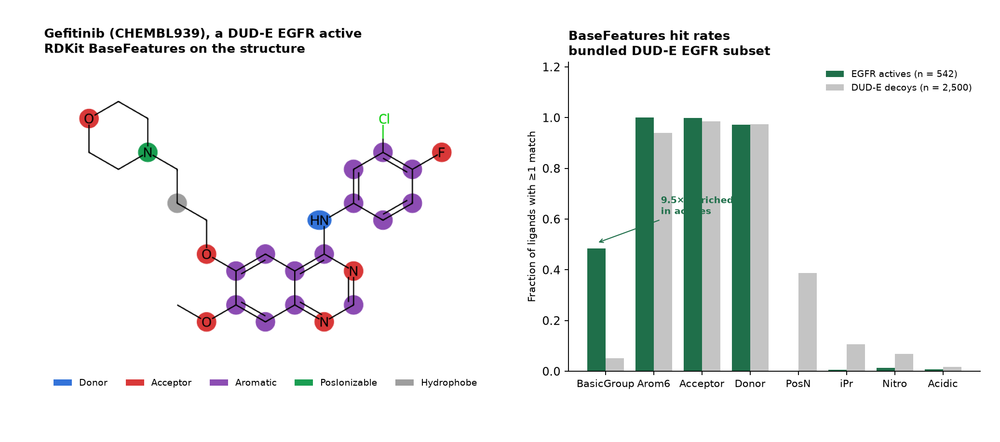

# pharmacophore-profiler

A practical ligand-based tool: give it a file of SMARTS patterns and a set of ligands, get back a table of per-ligand feature counts, then use that table to compare actives with inactives, filter a library, or flag structural alerts.

<p align="center">
  
</p>

<p align="center"><em>Gefitinib (CHEMBL939) with RDKit BaseFeatures highlighted, and hit rates on the bundled DUD-E EGFR subset (542 actives, 2,500 property-matched decoys). The basic-amine feature is 9.5× more common in the actives.</em></p>

## Quickstart

```bash
pip install -e .
# bundled EGFR actives + property-matched decoys, BaseFeatures pharmacophores
pharmprof profile data/dude-egfr/egfr_subset.csv.gz -p basefeatures -o counts.csv
pharmprof stats   counts.csv --labels data/dude-egfr/egfr_subset.csv.gz -o stats.csv
pharmprof screen  data/dude-egfr/egfr_subset.csv.gz -p basefeatures --require BasicGroup -o hits.csv
pharmprof alerts  data/dude-egfr/egfr_subset.csv.gz -c PAINS -c BRENK -c NIBR -o alerts.csv
```

Or from Python:

```python
from pharmprof import builtin_patterns, profile, compare_classes, apply_filter
from pharmprof.data import load_egfr

ligands  = load_egfr(subset=True)          # 542 actives + 2,500 DUD-E decoys
patterns = builtin_patterns("basefeatures")  # or "pmapper", "nibr2019", or a TSV path
table    = profile(ligands, patterns, n_jobs=-1)
stats    = compare_classes(table, ligands["label"], patterns)
hits     = table[apply_filter(table, require=["BasicGroup"], patterns=patterns)]
```

`pharmprof --help` and `pharmprof profile --help` list every option. Pattern files can be the bundled sets above, a TSV (`pattern_id, name, family, smarts, role, source, license, citation, enabled, notes`), a two-column `name<TAB>smarts` file, or an RDKit `.fdef`.

## What was measured on DUD-E EGFR

All numbers below were computed with this package on the bundled subset (542 unique actives, 2,500 sampled official decoys; see [`data/README.md`](data/README.md)). Ties in a ranking are broken randomly with seed 0 so file order cannot inflate early enrichment.

**Discriminating BaseFeatures pattern.** `PosIonizable.BasicGroup` (aliphatic / basic amines, for example the morpholine of gefitinib) is present in **263 / 542 actives (48.5%)** and **128 / 2,500 decoys (5.1%)**: enrichment **9.48**, odds ratio **17.5**, Fisher two-sided *p* = 2.7×10<sup>−126</sup>, Benjamini–Hochberg *q* = 7.2×10<sup>−125</sup>. Several other patterns (Arom6, Acceptor, Donor) are nearly universal in both classes and are not useful filters. Charged nitrogen (`PosN`), isopropyl, *tert*-butyl and nitro are significantly *depleted* in the actives. `AcidicGroup` and `ZnBinder5` are perfectly correlated (*r* = 1.0) — they are the same carboxylate.

**Hard filter** requiring `BasicGroup`: keeps 263 / 542 actives and 128 / 2,500 decoys (enrichment 9.48).

**Ranking by BasicGroup count:** ROC-AUC **0.719**, PR-AUC **0.447** (prevalence 0.178), BEDROC(α=20) **0.692**, EF0.5% **5.24**, EF1% **5.43** (the ceiling for EF1% on this set is 5.61).

**Gobbi Pharm2D fingerprint similarity**, max Tanimoto to a random 80-active query set, evaluated on the held-out 462 actives + 2,500 decoys (self-matches excluded): ROC-AUC **0.962**, PR-AUC **0.912**, BEDROC **0.968**, EF0.5% and EF1% **6.41** (the ceiling on that test set). DUD-E decoys are designed to be topologically dissimilar to the actives, so a 2-D pharmacophore fingerprint is expected to separate them well; treat this as a measurement on that benchmark, not as a claim about scaffold-matched decoys.

Worked examples that reproduce these numbers are in `notebooks/`.

## Commands

| Command | What it does |
|---|---|
| `pharmprof patterns` | List bundled pattern sets |
| `pharmprof profile` | Match every pattern against every ligand; write a count / binary / normalised table (chunked parquet for large libraries) |
| `pharmprof stats` | Hit rates, actives-vs-inactives enrichment, odds ratios, BH-corrected *p*-values, pattern–pattern correlation |
| `pharmprof screen` | Required / forbidden feature combinations, optional Gobbi Pharm2D scoring, optional EF / BEDROC / ROC-AUC / PR-AUC |
| `pharmprof alerts` | PAINS, BRENK, NIH via RDKit FilterCatalog (runtime, not vendored) and/or the bundled NIBR 2019 SMARTS |
| `pharmprof fetch-data` | Show the bundled EGFR subset; `--full` downloads the official DUD-E files |

3-D conformer generation and Pharm3D / EmbedLib matching live in `pharmprof.pharm3d` and notebook 05. They are optional and much slower than 2-D profiling — use them on a shortlist.

## Bundled patterns and licensing

The code is MIT (see [`LICENSE`](LICENSE)). Bundled SMARTS files keep their original licenses and citations; details are in [`pharmprof/pattern_data/NOTICE.md`](pharmprof/pattern_data/NOTICE.md).

| Set | N | License | Source |
|---|---:|---|---|
| `basefeatures` | 27 patterns, 8 families | BSD-3-Clause | RDKit `BaseFeatures.fdef` (Gobbi & Poppinger 1998) |
| `pmapper` | 30 patterns, 6 families | BSD-3-Clause | [pmapper](https://github.com/DrrDom/pmapper) / Pharmer-style SMARTS (Koes & Camacho 2011) |
| `nibr2019` | 444 alerts | BSD-3-Clause | RDKit Contrib, NIBR 2019 deck filters (Schuffenhauer et al. 2020) |

**Not vendored, called at runtime:** PAINS, BRENK, NIH, ZINC, and optional ChEMBL 23 alert catalogs through RDKit `FilterCatalog`. ChEMBL data are [CC BY-SA 3.0](https://chembl.github.io/chembl-licensing/). Daylight SMARTS examples are not included.

Benchmark ligands are a subset of DUD-E EGFR, copyright the Irwin Lab and the UC Regents; cite Mysinger et al., *J. Med. Chem.* 2012, [doi:10.1021/jm300687e](https://doi.org/10.1021/jm300687e). See [`data/README.md`](data/README.md).

## Tests

```bash
pip install -e ".[dev]"
ruff check pharmprof tests
pytest -q
```

CI runs ruff and pytest on Python 3.10 and 3.11.

## Citations

- Gobbi A, Poppinger D. Genetic optimization of combinatorial libraries. *Biotechnol. Bioeng.* 1998, 61, 47–54. [doi:10.1002/(SICI)1097-0290(199824)61:1\<47::AID-BIT9\>3.0.CO;2-Z](https://doi.org/10.1002/(SICI)1097-0290(199824)61:1%3C47::AID-BIT9%3E3.0.CO;2-Z)
- Koes DR, Camacho CJ. Pharmer: efficient and exact pharmacophore search. *J. Chem. Inf. Model.* 2011, 51, 1307–1314. [doi:10.1021/ci200097m](https://doi.org/10.1021/ci200097m)
- Schuffenhauer A, et al. Evolution of Novartis’ small molecule screening deck design. *J. Med. Chem.* 2020, 63, 14425–14447. [doi:10.1021/acs.jmedchem.0c01332](https://doi.org/10.1021/acs.jmedchem.0c01332)
- Baell JB, Holloway GA. New substructure filters for removal of pan assay interference compounds (PAINS). *J. Med. Chem.* 2010, 53, 2719–2740. [doi:10.1021/jm901137j](https://doi.org/10.1021/jm901137j)
- Brenk R, et al. Lessons learnt from assembling screening libraries for drug discovery for neglected diseases. *ChemMedChem* 2008, 3, 435–444. [doi:10.1002/cmdc.200700139](https://doi.org/10.1002/cmdc.200700139)
- Jadhav A, et al. Quantitative analyses of aggregation, autofluorescence, and reactivity artifacts in a screen for inhibitors of a thiol protease. *J. Med. Chem.* 2010, 53, 37–51. [doi:10.1021/jm901070c](https://doi.org/10.1021/jm901070c)
- Truchon J-F, Bayly CI. Evaluating virtual screening methods: good and bad metrics for the “early recognition” problem. *J. Chem. Inf. Model.* 2007, 47, 488–508. [doi:10.1021/ci600426e](https://doi.org/10.1021/ci600426e)
- Mysinger MM, Carchia M, Irwin JJ, Shoichet BK. Directory of Useful Decoys, Enhanced (DUD-E). *J. Med. Chem.* 2012, 55, 6582–6594. [doi:10.1021/jm300687e](https://doi.org/10.1021/jm300687e)
